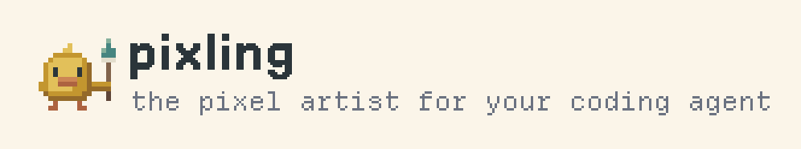
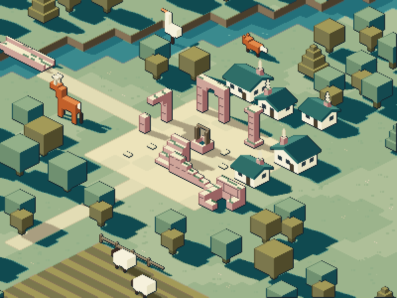
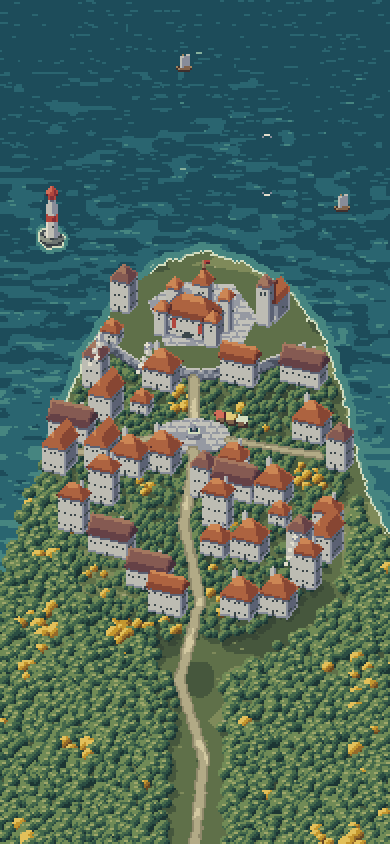
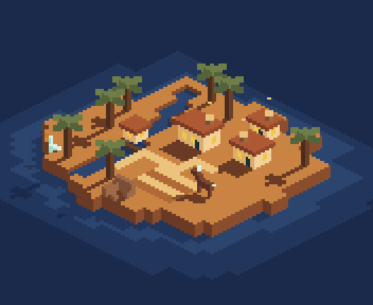
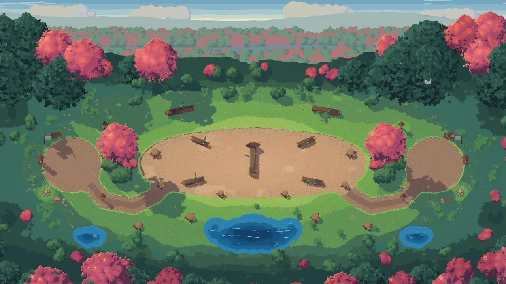
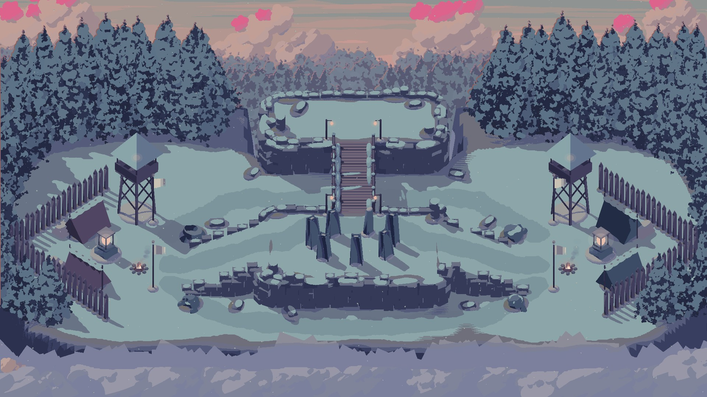
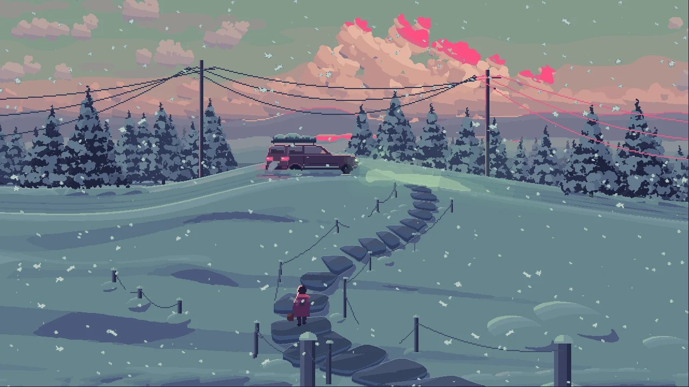
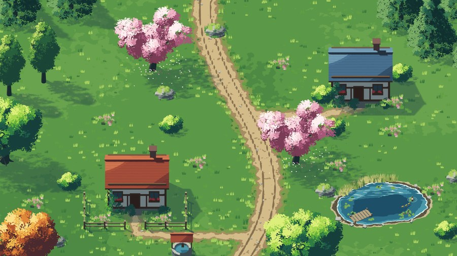
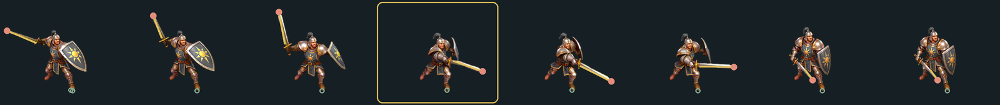

<p align="center">
  <picture>
    <source media="(prefers-color-scheme: dark)" srcset="docs/brand/pixling-banner-dark.png">
    
  </picture>
</p>

<p align="center">
  <b>The pixel artist for your coding agent.</b><br>
  Pipelines, styles and taste for making game sprites with code. Works with Claude Code, Codex and Cursor.<br>
  <a href="https://pixling.dev">pixling.dev</a>
</p>

<p align="center">
  
</p>

Coding agents can write your game, but they can't draw. pixling gives them pipelines that render real pixel art from
code, curated styles that ship with how they were made, and the taste rules behind them. The agent writes a spec,
builds it, looks at the result and iterates, the way it does with a failing test.

## Install
```bash
uv tool install pixling        # or: pipx install pixling   ·   or: npx pixling
pixling agent install .        # in your game repo: adds the skill and an AGENTS.md block
```
Python 3.9+. Some pipelines need more, and `pixling doctor` says what is missing: Blender 4.2+ for painted (and for
repainting arena maps), ffmpeg for video, `pip install 'pixling[reel]'` for lit sprites, Node + Playwright for
screenshots of the web views.

Then ask your agent:

> make a harbour town in the vista style, with lamps that light up at dusk, into assets/maps

## Quickstart
```bash
pixling new house_5 inn          # start a spec from an example -> specs/inn.json
pixling build specs/inn.json     # -> out/inn/: sprite sheets, GIFs, JSON
pixling review out/inn           # a zoomed sheet to judge by eye
pixling arena bundle --map emberleaf   # a painted battle map as one html; `pixling arena export` -> its level.json
pixling                          # every command; each takes -h, the ones agents parse take --json
```

## Pipelines
| Pipeline | Makes |
|---|---|
| **spec** | 8-direction sprites, props and buildings from a JSON spec, byte-for-byte reproducible |
| **blocks** | small iso units and creatures from a few voxel layers, in your board's projection, light and shadow |
| **iso** | exact 2:1 isometric scenes and animal sheets from a Python kit |
| **map** | living maps: building states, hour-of-day lighting, a meaning layer, engine layers |
| **fx** | VFX sheets posterised to a style's palette |
| **video** | sprites cut from AI video into 8-direction sheets (via [Scenario](https://scenario.com), optional), or lit side-view sprites with normal maps for 2D lights (web and Godot players) |
| **strike** | melee hits that land where the art paints them: weapon, feet and hurtbox measured in every frame of any sprite sheet, and the melee range the art supports |
| **painted** | painterly, non-pixel sprites and scenes rendered in Blender |
| **fp** | a walkable pixel world: a painted scene in layers with a small walker, or first person in WebGL |
| **arena** | painted battle maps for your units, with a checked game level: collision, nav, line of sight, zones |
| **style** | a new art style from scratch: refs, hand, kit, review |

`pixling pipelines NAME` shows each one's steps, code and lessons. Output is engine-ready: sheets, GIFs, JSON metadata,
`.aseprite` files, and for maps collision, depth and light layers.

## Styles
Three launch styles, each with its own hand (camera, shading, line, shadows) and kit. `pixling styles NAME --how`
shows how each was made.

| **Vista** | **Crisp Tactics** | **Flat Minimal** |
|---|---|---|
|  |  |  |
| painted aerial towns and world maps | exact isometric, flat faces, soft line | exact isometric, two hues, long flat shadows |

Everything above is rendered by the engine. Units and creatures for these boards are block tokens
(`pixling blocks`): a few voxels in the board's own iso, light and shadow.

## Painted worlds and battle maps
Not everything is pixels on a grid. These are rendered in Blender as data (light, material, depth), then painted into a
locked palette in Python, so a ramp can be tuned in seconds without a re-render.

| **Emberleaf Hollow** (arena) | **Hushfall Crossing** (arena) |
|---|---|
|  |  |
| a kill map in a clearing of red-crowned trees, 68 degrees | two camps, a ruin terrace and a bridge over a sea of dusk cloud, 40 degrees |
| **First Snow** (fp) | **Hollow Brook** (painted) |
|  |  |
| a painted place in layers with crisp pixel actors: walk anywhere, one html file | painterly sprites and scenes: swaying trees, paddling ducks, 8 headings |

The battle maps ship with a full game level: collision shapes, a nav grid per unit radius, line of sight, spawns and
zones, and `pixling arena check` proves both sides fair. The viewer (one html) shows the map's sway and drifting
clouds and overlays for sizing your units: colliders, nav, sight, paths, a test agent.

## Melee hits that land on their frame
`pixling strike` measures where the weapon, the feet and the body are in every frame of a sprite sheet, from the
alpha alone: no hand-drawn hitboxes. Then the art sets the rules. `pixling strike reach` gives the distances where
the contact frame's blade crosses a defender, so your melee spacing goes inside that band, and the guide shows how to
drive attack frames from your sim's ticks and the walk cycle from distance walked.



```bash
pixling strike sample                      # an example warrior to try it on, and the commands that measure it
pixling strike pose attack.png --cell 512 --pivot 256,379 --rows se,sw,ne,nw --hit 3   # or NAME.json --clip attack
pixling strike reach attack.pose.json idle.pose.json --scale 0.585 --ppm 40 --yscale 0.74 --stop 2.3   # exit 1 if outside
```
Any sheet and any engine. The default reads the silhouette, which suits painted and AI-video sprites; pixel art builds
a parts map from its rig (`pixling build SPEC --maps parts`: weapon, arms, legs, body) and strike reads that instead.
`pixling guide strike` has the formulas, the end-to-end tests to add and the limits.

## Docs
- [docs/PIPELINES.md](docs/PIPELINES.md): every pipeline, step by step
- [docs/ARTIST.md](docs/ARTIST.md): the spec format and design rules
- [docs/STYLES.md](docs/STYLES.md): the styles and how a new one is made
- [docs/ENVIRONMENTS.md](docs/ENVIRONMENTS.md): living maps
- [arena/README.md](arena/README.md): battle maps, using a map's level in your game, making a new map
- [fp/README.md](fp/README.md): walkable painted worlds and the first-person walk
- [painted/README.md](painted/README.md): the painterly format
- [reel/README.md](reel/README.md) and [reel/LIGHTING.md](reel/LIGHTING.md): sprites and lit sprites from AI video
- [strike/README.md](strike/README.md): melee hits that land on their frame

The same docs are built into the CLI: `pixling guide`.

## Develop
```bash
git clone https://github.com/trinity-works/pixling && cd pixling
pip install -e .
pip install -e '.[reel]'                  # optional: the lit-sprite build
python3 -m unittest discover -s tests     # the video tests need ffmpeg
```
Rules for agents working on the engine are in [AGENTS.md](AGENTS.md). Issues and pull requests are welcome.

## License
[MIT](LICENSE). Fonts in `docs/brand/fonts` and `site/fonts` are under the SIL Open Font License: wordmark in
[Jersey 15](https://github.com/scfried/soft-type-jersey) by the Soft Type Project, tagline in
[Departure Mono](https://departuremono.com) by Helena Zhang, site in Geist.
