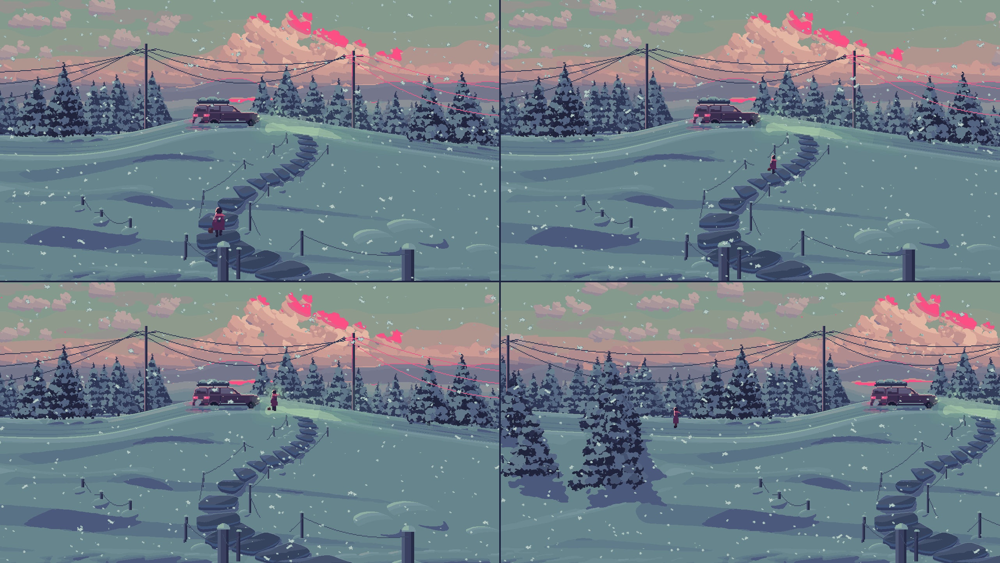

# fp — pixel worlds you walk through

Pixel Perfect's fourth engine, beside `pp/` (pixel sprites), `reel/` (video to sprites) and `painted/` (Blender
painterly sprites). It has two views of one place:

- **The painted view (what opens).** One composed third-person camera that sees a world about 2.5 screens wide; the
  place (`place.py`, in metres) is built in Blender with the painted engine's cards and stepped into a few layers
  (sky, ridges, trees, hill; `paint3d.py`, `hd2d.py`). The runtime (`web/layers.js`, canvas 2D) draws only what moves
  on top: a small figure you walk anywhere on the snow, her prints, snow, breath; the view follows her. Stable by
  construction: the layers are fixed pictures, offset in whole pixels, nothing re-rasterized as you walk. Two looks of the one place, switched by the page's Look button (or L, or `?look=`):
  - **painted** (`hd2d`, the default): the Blender render stepped into its ramps per render pixel, at the screen's own
    size (2x the art at 720p, a 3x render at 1080p); the walker, snow, breath, posts, poles, the car and the wires
    are crisp art-pixel accents over it (`hd_*.png` / `hd3_*.png`);
  - **pixel** (`?look=pixel`): the same render on the art grid, 2x2 block mode and cluster cleanup (the plain layer
    PNGs, which both looks also use for depth and colour lookups).
- **The first-person walk (`walk.html`).** A Python kit builds low-poly assets and a layout places them; a WebGL
  runtime walks you through the world in first person as **palette-locked pixel art**: a low internal resolution,
  banded toon light from the style's ramps, one low sun with a hard shadow map, every pixel snapped to the palette.
  It is the engine's lab; up close it reads as a 3D pixel filter, which is why the painted view opens.

| use | engine |
|---|---|
| palette-locked pixel sprites, 8 directions | `pp` |
| characters cut from AI video | `reel` |
| painterly sprites and scenes (Blender) | `painted` |
| **a walkable pixel world (a painted scene, or first person)** | **`fp`** (`pixling fp`) |

The first style is **Hushfall** (`styles/hushfall.json`) and its first place is **First Snow**
(`layouts/first_snow.py`): a winding stair through deep snow up to an old car parked at dusk on a snowy country road.



## Commands
```
python3 -m fp build                    # kit + layout -> out/fp/first_snow (index.html opens layers/, walk.html, fp.js, world.json)
python3 -m fp serve                    # play it: http://127.0.0.1:8770 (the folder needs a server)
python3 -m fp bundle                   # build, then the painted view as ONE html that opens from disk (file://), in a
                                       # sandboxed frame or served: <root>/first_snow.html (~4.7 MB; --out FILE)
python3 -m fp layers --t 1,12,22,34    # stills of the painted view + layers_sheet.png (~10 s); add look=pixel, nofx=1
FP_BPY=python-with-bpy python3 -m fp paint   # re-render the painted view into art/<layout> (~4 min; or FP_BLENDER=blender)
python3 -m fp walk [--t 0,6,12]        # build, then screenshots along the auto-walk + walk_sheet.png
python3 -m fp cards [pine:3 car:0]     # build, then assets alone on a snow disc from a few angles + cards_sheet.png
python3 -m fp shot "t=9&look=20,-5"    # any runtime view; look=YAW,PITCH in degrees
python3 -m fp film --t0 9 --seconds 5  # frames stepped through the runtime -> mp4 (judge head motion and breath)
python3 -m fp assets | styles | layouts
```
Every command takes `--root DIR` (its build folder: parallel sessions each use their own) and `--out DIR` (where
screenshots go). Screenshots use Playwright's headless Chromium with software WebGL (~5 s a shot).
Runtime URL queries: `t=SECONDS` jump the auto-walk, `pause=1` freeze time, `look=YAW,PITCH`, `card=MESH&yaw=&pitch=&dist=`,
`h=PIXELS` internal height, `nofx=1` no particles, `look=pixel` (the painted view's art-grid look), `motion=full|gentle|off`, `debug=shadow` (shadow and sun terms only).

## The painted view (`place.py`, `paint3d.py`, `hd2d.py`, `draw2d.py`, `blender/`, `web/layers.*`)
First Snow as a painting in layers, seen from one composed third-person camera pulled well back and raised to
about the crest (eye 7.6 m, 31.5 m behind the stair's foot, a long lens F=795), plus a near-field lens: below a seam
on the lower slope the scale grows faster than perspective and the ground drops further (`LENS_*`, the way a painter
draws the ground at her feet bigger and steeper). Everything goes through `place.ppm()`/`proj()`, so stones, posts,
ropes and the walker grow together; a painter's hero scale (`hero()`) keeps her ~28 px at the hold. The canvas is 1600
px wide, the same camera's wider frame: the composed picture (the old 880 px canvas, `CORE_X`/`CORE_W`; the clouds,
rims and veils are drawn in its columns) in the middle, the wider world on both sides (spruce stands, a buried fence
going on along a second drift, a field fence on the right slope, pillows, the wires running on to further poles;
`RAKERS`, `NEAR_SPRUCES`, `NEAR_PILLOWS`, `LIPS`, `BURIED_MORE`, `FIELD_FENCE`). Everything past the core draws after
it from the seeded streams, so the core's things stand where they stood. Spare sky above and ground below let the
runtime fill any landscape screen at a whole-number scale with no bars.

The pipeline, `fp paint` (cached by a hash of its inputs; the results are committed in `art/first_snow/`, so `fp build`,
`fp serve` and the tests need no Blender):
- **The place** (`place.py`): the camera, the terrain (a brow with no shelf, one wind drift, a groove for the stair),
  the road (`ROAD`, `road_cut`, `road_label`, `road_strip`: a plough-cleared lane along the crest that leaves the world
  behind the tree band at both ends, cut a little into the snow, two darker ruts in its near half, a low rounded plough
  ridge on each edge, trodden flat into a lighter shoulder where the stair arrives; it falls toward the camera across
  its width, a painter's cheat so it reads as a calm band from an eye this close to the crest), the S of irregular
  flagstones (bigger in metres near the camera, ending at the road's shoulder), the rope fence (two ropes by the foot
  sag into the snow, so she can step off the stair from the start) and an old fence buried in the drift, snow pillows,
  the spruce band and its framing spruces (the wings' near ones all past the near-field lens), the poles and wires,
  the car (an old estate about 1.15 x real size, `CS`, parked on the lane's near half, tyres in the ruts, nose toward
  the sun-side pole; she stands about as tall as its roof) and the walk route. The scattered things come from one seeded stream (`layout()`). Where she can walk is here too:
  `walk_grid()` (per 0.25 m cell the ground's height with the flagstones' tops, the surface: deep snow, the trodden
  path, stone, the road's packed lane or a plough ridge (her pace on each: `PACE`), the room: inside the frame, short of the crest and the trees, the road wherever it is in sight, a soft edge, and the headlamps'
  light)
  and `walk_blocks()` (posts, near spruces, big pillows and poles as circles, every rope clear of the snow as a
  segment, the car as a box).
- **Export and render** (`paint3d.export`, `blender/first_snow.py`, its own bpy script, nothing imported from
  `painted/`): the place in metres -> `scene3d.json` + `terrain.npz` + `road.npz` (the road's strip, its parts as
  materials of their own: lane, ruts and shoulder on ramps a step under and over the snow, the ridges as pillows), built with the painted engine's technique and
  rendered from the composed camera (the near-field lens is a vertex warp) once per layer at 2x (and 3x for 1080p), as
  data: R the lit value (diffuse through Shader to RGB, with shadows), G a material id, B depth. Spruces are tiers of
  camera-facing dab cards with tier normals, a skirt of dark hanging tips and a shelf of puff cards (buried cards
  darker, a gradient along the sun, no self-shadow: the sun is behind the band, so real self-shadow made silhouettes).
  The cumulus is puff cards in clumps whose shader computes each pixel's normal from the clump's and the cloud's
  centres (`cc`/`cs`, `ec`/`es`), so a clump shades as one soft mass with a flat slate-violet base, lit crowns on the
  upper right and the hot pink only on the top-right crown edge (material `pink`). The snow's normals are blurred over
  a few cells so it shades as big soft forms; the sun (back-left, ~49 deg up) casts real shadows from the trees,
  pillows, stones and the car, while posts and poles cast none. A rake pass (a low side sun and spruces off the frame's
  left edge, invisible to the camera) gives the long blue bands across the near snow (`RAKE_DARK`). The headlamps are a
  spot light with a pass of their own. `blender/walker.py` renders the walker the same way: soft primitives with
  sphere normals, six poses in one ortho render, plus a pass under the headlamps alone.
- **The art grid** (`paint3d.pixelize`): each material's lit value picks a band of its ramp (`RAMPS`: tune here, no
  re-render), each 2x2 block takes its most common colour, orphans and whiskers are cleaned red-black (`draw2d.mode_clean`: the
  two checkerboard halves in turn, so a checker collapses instead of swapping), snow bands are at least 2 px tall
  (`min_rows`), `stair_craft` gives every riser a lit top and a dark foot, contact rows and a snow lip, and `rim_lip`
  lights the hill's skyline. Then the drawing on the art grid (`draw2d.py`): the sky behind the clouds and the far
  hill, ridges with the sun's rim and the mist (`sky_back`, `far`), the posts, poles, ropes and wires as pixel sprites
  (`props`; their Blender copies only cast and catch light), the hand-drawn car (`car_sprite`, `paint_car`: a rounded
  old estate from its rear three-quarter in its own pixel grid, about 86 x 40 px, repainted to the low sun, seated on
  the lane in a contact pool with a little snow banked at the tyres, the tail lights' pink as a two-step bloom), and the headlamps' light: the spot's pass in three mint
  steps on the snow and the spruces, ending at the right pole, merged with a drawn low dome off the crest and a glow
  in the air where she stops (`lamp_field`), a faint beam cone and a hot core (`paint3d.lamp_light`). Output: the plain
  layer PNGs, `hill_depth.bin` (the runtime tucks the walker behind posts), `scene.json` (the route, the car's
  anchors, the shade lookup, the camera's terms and the walk's blockers), `walk.bin` (the walk grid) and the walker
  sheet (`walker_sheet`: one sprite per height over the walkable depths (~23-53 px), heading (8) and pose, plain and
  lamp-lit, a salmon rim on the up-left silhouette and short mint highlights in the lamp variant).
- **The painted world** (`hd2d.pixelize_hd`, the default look): the same data stepped per render pixel at the render's
  own size, only orphan specks cleaned (`HD_CLEAN`); the snow field a gouache stroke (its lit value blurred inside the
  snow before stepping, a mode filter, streaks and beads absorbed: `HD_SNOW_*`); the cumulus keeps the render's own
  dabs (a blur before stepping read as camouflage, a pink rim band as a neon outline: `HD_CLOUD_*`); the tree rows
  grouped by distance (`HD_ROWS`). The art-grid drawing comes back on top as s x s art pixels: the near posts as clean
  slabs (`slab_posts`), the ropes and wires refitted as one cubic each (`relay_lines`; on the fine grid at 3x), the
  car seated with its ground rounded onto the fine snow (`seat_car`), and the lamp's and tail lights' light fitted as
  tints and re-applied with fine seams (`relight`: shelves take the mint strongly, needle pockets faintly), a
  feathered pool edge (`feather_pool`) and a lantern without a disc edge (`lantern`).

The runtime (`web/layers.js`, canvas 2D, no WebGL) draws the painted world (`hd_*.png`, or `hd3_*.png` when the view is
scaled 3x) on a canvas of its own under a transparent art-pixel canvas that holds only the actors, SCALE x SCALE
screen pixels per art pixel. It opens on a 1.8 s still of the sky, then one slow tilt down; then the view follows her
sideways: a dead zone round the middle, an eased catch-up, clamped at the world's edges. The hill and the actors sit
at a whole art column; every layer behind at its own whole column, a share of the hill's move (`fx`: sky 0.72, ridges
0.86, trees and hill 1; the poles and wires on the hill stand on the trees layer's far snow, so those two move as
one), so the world is rigid between steps and nothing shimmers; the world canvas is redrawn only when an offset
changes (`drawImage` per layer). It mirrors `place.proj` from `scene.json`'s `camera` block and walks her in metres on
`walk.bin`: her feet's height and what is underfoot from the grid (deep snow 0.7x the pace of the stones, the
trodden path and the road, a plough ridge 0.85x), the room's soft edge fading the outward part of a move, circles,
segments and a box pushing her round posts, ropes, spruces, pillows, poles and the car (behind something nearer she
shows as a faint flat silhouette). Up is into the picture (along the view's ray through her, so she
keeps her column). A click or a tap walks her to the spot along a distance field over the grid, pulled taut round
corners; R or Walk on takes her up to the car. The walker is the sprite sheet at her height in 1 px steps and her
heading (8, from her move in the screen-relative frame, with a little slack so she never flickers), poses held 4 per
step with a 1 px bob, the pink scarf's tail streaming downwind from the knot (behind her body when she faces us)
lagging a pose and fluttering on a held 4-step cycle, a soft contact shadow (a flat oval most of a tone darker, lighter at its ends), and in the snow a print per step
part of a tone darker than the snow (1-3 px by depth, kept a minute, gone after five, behind anything nearer; on the
lamp-lit snow the shade lookup holds the lit colours' own darker tones, `paint3d.lit_shade`); the lamp-lit variant
where the headlamps' light falls; the suitcase is set down at the hold, where the air behind her hood brightens in
two flat steps and a warm chord swells (`audio.swell`). Footsteps crunch in snow, knock on stone and squeak on the road's packed snow. Breath (from her
mouth, turned with her) and exhaust are two-tone puffs. Snow comes in three depth classes in front of the painting,
each a hand-made pixel stamp: far 1-2 px specks, mid 3-4 px irregular clusters, near 5-9 px broken clumps (irregular,
a little long, a pale core, a mid tone, a ragged snow-teal edge, a crystal or two come loose) that tumble through
four orientations in held steps and turn see-through over her. Every flake falls at its class's speed (31-80 px/s,
the bigger the faster, so at 30 fps each moves down at least a pixel a frame), sways on a slow sine of its own and
drifts on a light wind to the right; when the view steps sideways the air shifts against it (the near flakes most);
it ignores the opening tilt (coupled to it, it rose) and comes back above the top edge or off a side, never
mid-screen. A few far flakes catch the sun's pink while they are high over open sky. Controls: arrows or WASD
(screen-relative), a click or tap to walk to a spot, on touch screens a floating stick under the left thumb; R walks
on, M sound, L the look. `?at=X,Z[,HEADING]` starts her there (the Look button carries it).

The built page is a static folder with relative paths: `fp build` copies the layout's painted view (`art/<layout>/`,
made by `fp paint`; `place.NAME` is the layout `place.py` paints) and the page into `<root>/layers/` and makes
`<root>/index.html` open it (a layout with no painted view opens its first-person walk instead) (the first-person walk is `<root>/walk.html`, the default page of
`fp shot|walk|film|cards`; `fp layers` shoots stills of the painted view, `fp film --page layers/index.html` steps it).
It loads `index.html`, `layers.js`, `audio.js`, `fonts/GeistPixel-Square.woff2`, `scene.json`, `sky.png`, `ridges.png`,
`trees.png`, `hill.png`, `hill_depth.bin`, `walk.bin`, `walker.json`, `walker.png`, and in the painted look `hd_sky.png`,
`hd_ridges.png`, `hd_trees.png`, `hd_hill.png` (or `hd3_*.png` of the same four when the view is scaled 3x). Copy the
folder anywhere; it needs an http server, not `file://`.

**One file (`fp bundle`).** `fp/bundle.py` packs that folder into a single html that opens from disk: every file the
runtime loads goes into a table of data: URIs (`window.__FP_FILES`) that the runtime's one resolver, `asset(path)`,
looks each fetch and image up in; `layers.js` is inlined and `audio.js` reaches it through the page's import map
(`"fp-audio"`), whose entry becomes a data: module; the font's CSS `url()` becomes a data: URI. Nothing in the code is
rewritten. Bundled, the page drops its link to the first-person walk; its Look button carries the walk over the reload
in the query, or in sessionStorage (window.name where storage is blocked) when the page's URL holds no query (a
sandboxed or srcdoc frame). The test (`tests/test_fp.py`) checks that every file the page loads is in the table.

## Stable pixels: texel splatting (`web/texel.js`)
Pixelating a 3D frame on the screen grid makes the pixels crawl over every tree and snowbank whenever the camera
moves, even with a head bob: each frame re-rasterizes the world onto the same screen grid. Snapping the camera to
that grid (the usual fix) only works for orthographic cameras; under perspective, near and far things shift by
different amounts. So fp draws its art pixels in the world instead, after Dylan Ebert's *Texel Splatting:
Perspective-Stable 3D Pixel Art* (2026, arXiv 2603.14587):

1. **Probe.** The shaded world is rendered into a cubemap from a point snapped to a grid (`texel.cell` across,
   `texel.cell_y` up, in metres). Shading,
   fog, rim and dither see that point, not the eye, so they are the same every frame. Each texel stores its colour
   and its Chebyshev distance from the probe.
2. **Bake**, once per probe: an equi-angular grid of `texel.size` texels per face (one pixel size across the view)
   samples the capture, snaps each texel to the palette and notes which sides face a depth jump.
3. **Splat**, every frame: every texel becomes a square in the world at its own distance, grown half a texel toward
   a depth jump so a moved eye sees no slits. Turning or bobbing moves them rigidly; walking inside a cell leaves
   them in place; crossing into the next cell captures the next probe over three frames, then each texel of the old
   probe drops out at its own moment within `texel.fade` seconds (a per-texel hash, never a screen pattern), so the
   swap reads as a brief settle, not a repaint. Bigger cells mean fewer swaps.
4. **Fill**: the few spots the probe can't see (behind a post, under a step) are drawn plainly where the stencil
   says no splat landed. Particles are drawn last in whole art pixels on the art-pixel grid.

`?render=screen` draws the old way (low-res target and palette snap), and is used where a float render target is
missing. Headless screenshots run in software WebGL: a texel-splat frame takes about a minute there (a real GPU
draws it in a few milliseconds), so `fp walk` and `fp film` are slow; `fp shot "...&render=screen"` is quick.

## How a frame is shaded (`web/fp.js`)
1. **Sky**: a panorama painted by `sky.py` at the splat texel size (0.225° a pixel): cumulus clumps of overlapping
   round puffs, painted back to front so lower puffs overlap higher ones (scalloped salmon tops over rose and mauve
   bellies, banded with an ordered dither for a soft painterly edge), high cool wisps, hot-pink clusters with specks
   drifting off them, ridges with a pink rim on the sun side. It is its own layer behind the world: each screen pixel
   looks up the panorama pixel in its direction, so sky pixels stay pinned to the sky (`sky.drift` moves the clouds a
   whole pixel at a time; Hushfall keeps them still). Tune it in the style's `sky.cumulus` and `sky.accent`.
2. **World**: light value
   `v = ambient + sky·(n.y) + sun·terminator(n·L)·shadow`, times baked AO; `v` picks a band of the material's ramp.
   Faces that point up enough turn to snow (`snow` per vertex, world-pinned noise for ragged edges). Snow fields are
   lit as if nearly flat (`snow.flatten`), so drifts don't band: one calm teal mass broken only by shadows. Rounded
   snow (pillows along the stair, post caps and feet, the car's blanket) is the `drift` ramp, lit with its own normals,
   so it gets a soft highlight on top: the fluffy, friendly shapes. Faces turned to
   the low sun and seen edge-on take the `rim` ramp. Headlights add `glow` bands with a dithered fringe (the dither pinned to 5 cm world cells). Fog steps
   toward the haze in `fog.steps` bands. Each lamp spills its own ramp (`glow` mint for headlights, `tailglow` pink
   for tail lights). Instanced copies of materials in `tone_jitter` sit a little lighter or darker by position.
3. **Lines**: ropes, wires, grass and paving seams are 1 px lines (drawn a capture pixel thick in probes).
4. **Particles**: falling snow, a near shell of big bokeh flakes, the breath (a solid core with a dithered
   rim, the dither in the puff's own pixels so it travels with the puff; it leaves the mouth at the walker's speed, the still air stops it and you walk into it) and the exhaust of
   anything with an `exhaust` anchor.
5. **Palette**: every pixel is a palette colour (snapped per texel in the bake, or per pixel in the screen path).

The walker: an auto-walk along the layout's `route` (idle, walk, slow to a stop by the car, look around) until any
key, drag or tap takes over (WASD/arrows and mouse look; on touch screens an on-screen stick walks, with a
floating base under the left thumb, and dragging the right side looks; R or the Walk on button resumes, M or the button
softens the head motion).
The intro looks up the climb at the car (`start.pitch` lifts it), then the gaze eases onto the stair, averaged over
the next few metres and pulled toward the car, so curves never swing the head (turn rates stay under ~15°/s).
Sound (the button) is synthesized: wind, a crunch per footfall, the exhale, the car idling louder as you near it.
Head motion: an idle breathing rise, and while walking a dip per footfall, a sway per stride and a little roll; the
eye height follows the stair through a spring. `prefers-reduced-motion` starts it gentle.

## Files
| path | what |
|---|---|
| `styles/*.json` | a look: pixel height, camera, sun, light, `ramps` (material -> `[position, hex]` stops), snow, fog, sky, particles, bob |
| `kit/*.py` | one builder per asset family (`build(seed) -> Asset`); `kit/__init__.py` registers them |
| `layouts/*.py` | a place: terrain, path, steps, placements, ropes and wires, the walk route |
| `mesh.py` | the shapes: `box`, `frustum`, `cylinder`, `lathe`, `sphere`, `prism`, `quad`, `tube`, `catenary`, `spline`; `Lines` |
| `build.py` | packs it all into `world.json` + `world.bin` |
| `web/` | `index.html`, `fp.js` (the runtime), `texel.js` (texel splatting), `audio.js` (synthesized wind, footsteps, breath, engine idle), `vendor/` (three.js r180, MIT), `fonts/` |
| `place.py` | the painted view's place in metres and its camera (terrain, stair, props, poles and wires, car, route) |
| `paint3d.py`, `hd2d.py`, `draw2d.py`, `blender/first_snow.py`, `blender/walker.py`, `art/first_snow/` | the painted view: export, Blender data render (the place, the walker), the art grid, the painted world at screen size, the 2D drawing over it; the committed layers |
| `web/layers.html`, `web/layers.js` | the painted view's page and runtime |
| `shot.py`, `shot.mjs` | screenshots, cards and contact sheets through the real runtime |

## Making assets
- An asset is a `Mesh` in metres, y up, origin on the ground, front toward -z, plus optional `Lines`, a collider
  (`collide` radius or `box`), `lights` (spots: `pos`, `dir`, `angle`, `range`, `power`, `ramp`), `anchors` (an
  anchor named `exhaust*` puffs smoke) and `sink`.
- Every vertex names a **material** (a ramp in the style), a **snow** catch (0-1) and an **ao** (0-1). Pieces are
  flat-shaded: facets are what make banded light read. Build big shapes first; small parts vanish at ~216 px.
- Shapes compose with `+` and place with `.at()`, `.turn(yaw, pitch, roll)`, `.scale()`, `.tag()`, `.jitter()`.
- Thin things (ropes, wires, blades, antennae, seams) are `Lines`, not tubes: a 1 px line never shimmers away.
- New colours go in the style's `ramps`; content names materials, never hex.
- Judge at game zoom in `cards` and `walk` sheets, next to the reference. One light, one palette, one pixel size.

## Rules of the hand (Hushfall)
- One sun, low on the left; every asset shades and casts from it. No outlines; edges come from value.
- The palette is closed: ramps + the sky's colours + `palette_extra`. The post pass snaps anything else.
- Dither only where declared: the sky's band borders, the headlight fringe, the breath's rim. Never on snow fields,
  and never in screen space: every dither is pinned to the world, the sky or the particle, so walking never repaints it.
- The hot pink belongs to the setting sun: rims, the ridge line, the sky clusters, the tail lights. Nothing else.
- Head motion stays small (see `bob`); the camera never rolls more than a degree.
